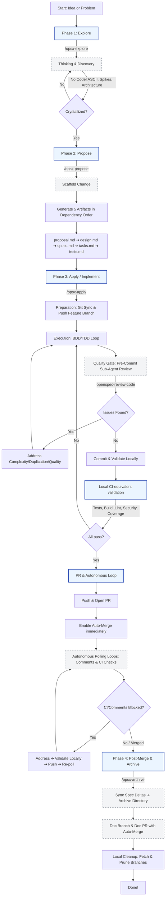
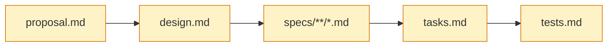

# OpenSpec Spec-Driven Development Workflow Guide

This document outlines the standard Spec-Driven Development (SDD) workflow using the custom **`sdd-with-feedback-loop`** schema. 

This workflow provides a strict, feedback-driven pipeline designed to establish a **Single Source of Truth** for planning, design, specs, tasks, implementation, and quality assurance. It is built to be easily understood by human developers while providing explicit, machine-readable rules and commands that AI coding agents can execute autonomously.

---

## High-Level Workflow Overview

The lifecycle of a code change progresses through four phases. The flow is iterative: feedback from local pre-commit reviews, validation failures, or PR reviews will loop execution back to earlier phases as needed to maintain high quality.



---

## Detailed Phase Guide

### Phase 1: Explore (`/opsx-explore`)

**Stance**: Curious, open-threaded, visual, patient, and grounded. 
**Objective**: Understand the problem space, mapping integration points in the codebase, researching choices, and listing risks and unknowns.

> [!WARNING]
> **Explore mode is strictly for thinking, not implementing.** Under no circumstances should application code be written or modified in this phase. The only files that may be created are conceptual notes or ASCII architecture diagrams.

*   **Action**: Use `/opsx-explore` followed by a vague idea, specific problem, or target capability.
*   **Codebase Inspection**: Check for active context using:
    ```bash
    openspec list --json
    ```
*   **Visualizing**: Leverage ASCII diagrams to map dependencies, state transitions, or database layouts.
*   **Transition**: When the shape of the change crystallizes, transition to the proposal phase.

---

### Phase 2: Propose (`/opsx-propose`)

**Objective**: Generate the 5 core implementation artifacts in strict dependency order, ensuring that all architectural details, edge cases, BDD acceptance scenarios, and testing plans are locked in before writing code.



#### Step-by-Step Generation Flow

1.  **Initialize the Change**:
    ```bash
    openspec new change "<change-name>"
    ```
    This scaffolds the directory `openspec/changes/<change-name>/` with `.openspec.yaml`.

2.  **Generate Core Artifacts**:
    Run `openspec status --change "<change-name>" --json` to read the build order, and iteratively create the following files under `openspec/changes/<change-name>/`:

    *   **`proposal.md`**: Outlines *why* the change is needed, the problem space (current vs desired behavior, edge cases, assumptions), in/out scope boundaries, risks, open questions, and non-goals.
        *   *Change Control Note*: Include a statement that if the scope changes during implementation, all artifacts must be updated and re-approved before proceeding.
        *   *Task Assignment*: If this is issue-driven, assign the issue to the current owner.
    *   **`design.md`** (Requires `proposal`): Technical design mapping the proposal to implementation decisions. Includes architectural touchpoints, goal/non-goal mappings, architectural decisions (ADRs), functional & non-functional requirement mappings, rollback plans, and an operational blocking policy.
    *   **`specs/**/*.md`** (Requires `proposal`, `design`): Capability specifications detailing exact behavior changes.
        *   Use `ADDED`, `MODIFIED`, and `REMOVED` sections.
        *   Document acceptance criteria strictly using BDD scenarios (**Given / When / Then**).
        *   Ensure explicit traceability back to `design.md` requirements.
    *   **`tasks.md`** (Requires `specs`): The complete, sequential checklist of activities. Must cover: Preparation, Execution, Pre-Commit Code Review, Validation, PR and Merge, and Post-Merge.
    *   **`tests.md`** (Requires `tasks`): Strict test-driven cases mapped directly to tasks in `tasks.md` and acceptance scenarios in `specs/**/*.md`.

> [!IMPORTANT]
> When generating artifacts, `context` and `rules` provided by the schema are **constraints for the author (or agent)**, not contents to copy-paste. Never leave raw template instructions or boilerplate markers inside the generated markdown documents.

---

### Phase 3: Apply (`/opsx-apply`)

**Objective**: Implement `tasks.md` with BDD/TDD, then drive the PR to merge. The process is defined once, in `skills/openspec-apply-change/SKILL.md`; this guide summarizes it.

1.  **Preparation**: checkout the default branch, `git pull --ff-only`, create the feature branch, push it to remote.
2.  **Execution (per task)**: write a failing test (add the case to `tests.md`) → minimal code to pass → refactor → check off the task.
3.  **Local validation**: run the repo's CI-equivalent checks (tests, build, lint/static analysis, security checks, coverage). Commands and thresholds come from the repo's README / CLAUDE.md / AGENTS.md and CI config; this workflow names no tools. All must pass before any push.
4.  **Pre-commit review**: before every commit, a sub-agent runs `openspec-review-code` and the primary agent fixes all findings. The first review covers the whole branch; later ones cover only changes since the last reviewed commit.
5.  **PR**: push, open the PR (`Closes #N` for issues in `proposal.md`), enable auto-merge immediately (`gh pr merge <URL> --auto --merge`, never `--admin`).
6.  **PR loop**: the agent polls autonomously. A cheap state check first; one GraphQL query for unresolved threads and required-check status; fix every failing required check and open thread in one pass, validate locally, review, push once, wait 3 minutes, repeat until `MERGED` (or notify the user on `CLOSED`).

> [!IMPORTANT]
> **Apply is complete only when the PR is merged with every required CI check passing**, including the repo's quality gates and coverage requirements. Fix failures in code. Never waive, lower, skip, or disable a check; if a gate looks wrong, ask the user. The change as a whole is done only after the archive stage.

---

### Phase 4: Post-Merge & Archive (`/opsx-archive`)

Defined in `skills/openspec-archive-change/SKILL.md`:

1.  Verify the PR is merged, CI passed, and comments are resolved.
2.  Sync approved delta specs into `openspec/specs/`.
3.  Move the change to `openspec/changes/archive/YYYY-MM-DD-<name>/` in a **single commit** (stage the new path and the deletion together).
4.  Publish through a `doc/archive-YYYY-MM-DD-<name>` branch and PR with auto-merge; never push directly to the default branch. Monitor it like the implementation PR.
5.  `git fetch --prune` and `git branch -d <feature-branch> doc/archive-YYYY-MM-DD-<name>`.

---

## Agent Instructions

*   **Phase discipline**: no application code during Explore or Propose.
*   **No placeholders**: artifacts are fully fleshed out, never `TODO` text.
*   **Traceability**: the spec's Traceability block links requirements to scenarios and tasks; `tests.md` cases map to tasks and scenarios.
*   **Process lives in the skills**: do not restate it in artifacts; reference it.
